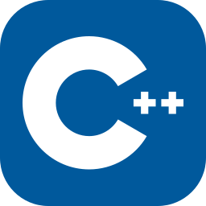
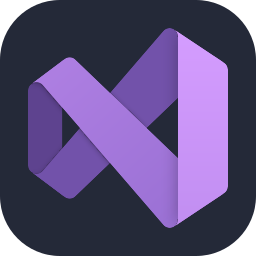
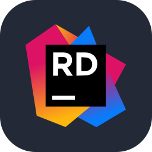
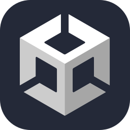
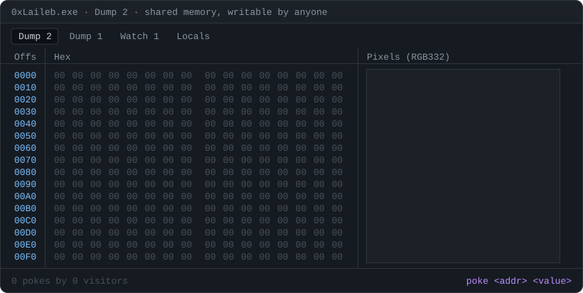
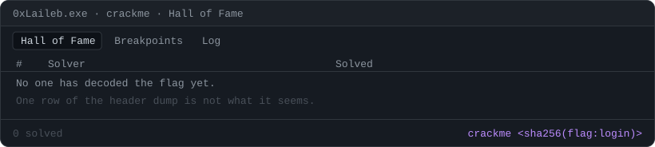
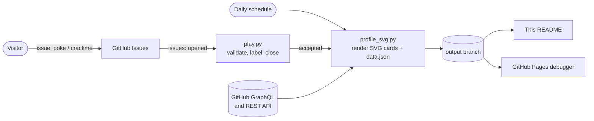

<picture>
  <source media="(prefers-color-scheme: dark)" srcset="assets/header-dark.svg">
  <source media="(prefers-color-scheme: light)" srcset="assets/header-light.svg">
  
</picture>

  
  
  
  <picture><source media="(prefers-color-scheme: dark)" srcset="assets/icons/dark/python.svg"></picture>
  <picture><source media="(prefers-color-scheme: dark)" srcset="assets/icons/dark/postgres.svg"></picture>
  
  
  <picture><source media="(prefers-color-scheme: dark)" srcset="assets/icons/dark/ubuntu.svg"></picture>
  
  <picture><source media="(prefers-color-scheme: dark)" srcset="assets/icons/dark/visualstudio.svg"></picture>
  <picture><source media="(prefers-color-scheme: dark)" srcset="assets/icons/dark/rider.svg"></picture>
  <picture><source media="(prefers-color-scheme: dark)" srcset="assets/icons/dark/vscode.svg"></picture>
  <picture><source media="(prefers-color-scheme: dark)" srcset="assets/icons/dark/claude.svg"></picture>
  <picture><source media="(prefers-color-scheme: dark)" srcset="assets/icons/dark/codex.svg"></picture>
  <picture><source media="(prefers-color-scheme: dark)" srcset="assets/icons/dark/unity.svg"></picture>
  <picture><source media="(prefers-color-scheme: dark)" srcset="assets/icons/dark/blender.svg"></picture>

> C#/.NET developer from the Windows side of things: desktop apps (WPF, WinForms), ASP.NET Core backends and whatever lives in process memory.

### 🔭 What I'm into

- 📈 **Trading & markets**: my own portfolio analytics on the T-Invest API (.NET microservices, technical analysis, AI and ML signals, backtests) and strategy research with AI agents. Stocks and crypto.
- 🌐 **VPN & networks**: self-hosted VPN infrastructure on Remnawave and Xray-core, proxies, and automation for VPS fleets.
- 🤖 **Vibe coding & AI**: building with Claude Code and Codex, local LLMs and media generation on my own GPU, small browser games.
- 🛠️ **Windows internals**: low-level debugging and reverse engineering of native Windows apps.

<picture>
  <source media="(prefers-color-scheme: dark)" srcset="https://raw.githubusercontent.com/0xLaileb/0xlaileb/output/stats-dark.svg">
  <source media="(prefers-color-scheme: light)" srcset="https://raw.githubusercontent.com/0xLaileb/0xlaileb/output/stats-light.svg">
  
</picture>

<picture>
  <source media="(prefers-color-scheme: dark)" srcset="https://raw.githubusercontent.com/0xLaileb/0xlaileb/output/activity-dark.svg">
  <source media="(prefers-color-scheme: light)" srcset="https://raw.githubusercontent.com/0xLaileb/0xlaileb/output/activity-light.svg">
  
</picture>

### 🕹️ Attach a debugger

This profile is a live process. **[Open the interactive debugger](https://0xlaileb.github.io/0xlaileb/)** to step through it, or poke it right here.

**Shared memory.** These 256 bytes belong to everyone. Open an issue titled `poke <addr> <value>` and a workflow writes the byte and redraws the picture: the address is the cell (`00`..`FF`, row by row), the value is an RGB332 colour.

<a href="https://github.com/0xLaileb/0xlaileb/issues/new?title=poke+00+E0">
  <picture>
    <source media="(prefers-color-scheme: dark)" srcset="https://raw.githubusercontent.com/0xLaileb/0xlaileb/output/memory-dark.svg">
    <source media="(prefers-color-scheme: light)" srcset="https://raw.githubusercontent.com/0xLaileb/0xlaileb/output/memory-light.svg">
    
  </picture>
</a>

  <a href="https://github.com/0xLaileb/0xlaileb/issues/new?title=poke+00+E0"><code>poke 00 E0</code> red</a> ·
  <a href="https://github.com/0xLaileb/0xlaileb/issues/new?title=poke+00+1C"><code>poke 00 1C</code> green</a> ·
  <a href="https://github.com/0xLaileb/0xlaileb/issues/new?title=poke+00+03"><code>poke 00 03</code> blue</a> ·
  <a href="https://github.com/0xLaileb/0xlaileb/issues/new?title=poke+00+FF"><code>poke 00 FF</code> white</a> ·
  <a href="https://github.com/0xLaileb/0xlaileb/issues/new?title=poke+00+00"><code>poke 00 00</code> erase</a>
  (edit the address in the title before submitting)

**Crackme.** One row of the dump at the top of this page is not what it seems. Recover the flag and claim your line below.

<picture>
  <source media="(prefers-color-scheme: dark)" srcset="https://raw.githubusercontent.com/0xLaileb/0xlaileb/output/fame-dark.svg">
  <source media="(prefers-color-scheme: light)" srcset="https://raw.githubusercontent.com/0xLaileb/0xlaileb/output/fame-light.svg">
  
</picture>

How to submit

1. Find the 16-character flag. It looks like `0xL{...}`.
2. Compute `sha256("<flag>:<your GitHub login in lowercase>")`. The [debugger](https://0xlaileb.github.io/0xlaileb/) has a Crackme tab that does it in your browser.
3. Open an issue titled [`crackme <64 hex digits>`](https://github.com/0xLaileb/0xlaileb/issues/new?title=crackme+PASTE_YOUR_PROOF_HERE).

The proof only works for your own login, so nobody can copy it, and the flag itself never appears in public. Please keep it that way.

Hint

Bytes that a debugger paints red were modified at run time. The key is two bytes long, and this process has been showing it to you since the title bar.

How this page works

No state is stored in the repository: the shared memory and the hall of fame are rebuilt on every run from the closed issues that the workflow labelled. Everything is generated by one dependency-free Python script in [`tools/`](tools).

  

